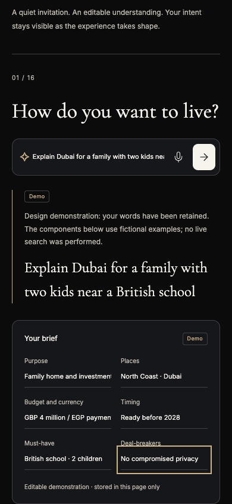
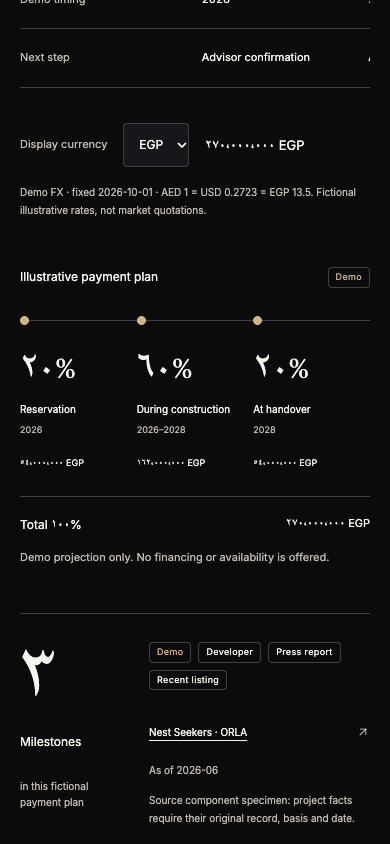

# Karim Hassan · Stage 1 initial review

This is a **simulated client perspective on Stage 1 Foundation & Design System**, not a client interview, native Gulf Arabic assessment or accessibility certification. The reviewer implemented auth/preferences in the legacy app, but did not implement or edit the `/design` guide. These scores judge the guide and component readiness for the next stage. Production concierge intelligence, live maps, actual finance offers and complete private-office workflows belong to later stages and are not being marked as missing Stage 1 features.

## Evidence and six steps

The supplied v2 matrix contains EN/AR, dark/light and 390/1024/1440 captures. Representative images were opened at desktop, tablet and mobile sizes, including English dark full-page, Arabic dark 1024 arrival, Arabic light 390 arrival, Arabic sheet and English evidence section. Its manifest records **12 configurations, zero axe findings, zero page errors and zero horizontal overflow**. That is automated evidence, not a claim that every assistive-technology flow passes.

Independent fresh interactions used `/en/design?theme=dark` and `/ar/design?theme=light` at **390×844, reduced motion**, and produced [client-interactions.json](client-interactions.json) and the numbered screenshots below. All three persona prompts were submitted in both languages. All six fields were edited manually; no automatic extraction was claimed or expected in this component guide.

1. **Arrival — strong.** Deliberate display typography and restrained color; first Tab reaches the skip link. See `01-{en,ar}-arrival.png`.
2. **Conversation and brief — mixed.** Submitted words are retained verbatim beside an explicit design-demo disclosure. Six fields retain edits, but realistic Purpose and Budget/payment wording clips within narrow mobile single-line inputs. See `02-{en,ar}-brief.png`.
3. **Currency and payment — correct with consistency gaps.** AED 20,000,000 becomes USD 5,446,000 or EGP 270,000,000 with the stated fixed fictional rates. EGP installments are 54M/162M/54M and total 270M. The independent amount strip explicitly says it is not a conversion. Numeral switching updates prices, percentages and statistics, while timing and area specimens remain Latin. See `03-{en,ar}-currency.png`.
4. **Layer and sheet — partly convincing.** Schools toggles its pressed state and visible status. Enter opens the sheet; Escape closes it and restores the trigger. Expand changes the label but does not increase the visible specimen height: approximately 618px EN and 594px AR before and after. See `04-{en,ar}-sheet.png`.
5. **Command palette — navigation works, focus destination does not.** Search, no-result feedback, ArrowDown and Enter work in both languages. Selecting Evidence scrolls its top to approximately y24, yet active focus returns to the off-screen header trigger. Opening also initially focuses Close rather than Search. See `05-{en,ar}-palette.png` and JSON focus measurements.
6. **Recovery — clear.** Keyboard retry replaces the interrupted state with a localized ready message. No horizontal overflow occurred in the two independent flows. See `06-{en,ar}-recovered.png`.

The native database report independently supplied by the parent records PostgreSQL 16.2 + pgvector, 250 fictional units, 13 reference projects, 9 reference organizations and zero invalid unit attachments. The parent reports 40 unit tests and 36 legacy AI evaluations passing, plus lint/typecheck/format. These support foundation confidence; they do not prove this guide's full screen-reader behavior or current external market truth. Local controls felt responsive; this run did **not** measure production LCP/INP, physical-device frame rate, or benchmark the supplied videos. Native Arabic review and real assistive-technology testing remain outstanding. An AR tab sequence reached BODY/browser focus; no background form activation was demonstrated, so this is not reported as a proven modal escape bug.

“The conversion and payment arithmetic are finally inspectable. My decision spans currencies and two purposes, so the brief needs to expose every word as clearly as the total.”

## Scorecard

Scores concern Stage 1 component merit. AI-first means composer/brief readiness; map experience means spatial controls/sheet readiness. Neither score asserts a functioning production concierge or living map. Motion and speed remain bounded by the local evidence described above.

| Criterion            |    Score |
| -------------------- | -------: |
| First-5-seconds wow  |        9 |
| Originality          |        9 |
| AI-first             |      8.5 |
| Map experience       |      8.5 |
| Visual craft         |        9 |
| Motion quality       |      8.5 |
| Arabic & RTL         |      8.5 |
| Trust & evidence     |        9 |
| Discretion & privacy |      9.5 |
| Developer appeal     |        9 |
| Speed                |      8.5 |
| Accessibility        |        8 |
| **Mean**             | **8.75** |

## Three delights

1. “I can reconcile the payment plan.” USD and EGP totals and 20/60/20 installments match the stated static rates; the plan explicitly calls them fictional, dated rates rather than market quotations.
2. “Different figures are not being passed off as exchange equivalents.” The source-like AED/EGP/USD strip labels its amounts independent. The comparison retains AED while the separate converted specimen and timeline respond to the display currency.
3. “I can keep two markets and two purposes in the brief.” Manually entered North Coast · Dubai, family home/investment and readiness before 2028 persist in the page, and the original bilingual request is fully retained.

## Three problems to resolve

1. “The exact distinction between my budget currency and payment currency disappears at a glance.” `GBP 4 million / EGP payment` and its Arabic counterpart overflow the mobile input. A scrollable text input retains data, but is a weak review surface for this important distinction.
2. “The number system changes only part of the financial story.” With Arabic-Indic enabled, payment amounts/percentages update while years and comparison areas remain Latin. Isolate date ranges in RTL and use a consistent numeral policy. The guide currently demonstrates only AED/USD/EGP; GBP in the broader app is not independently exercised in this guide review.
3. “My keyboard goes somewhere different from my view.” Selecting Evidence moves the viewport but returns focus to the header. The sheet expansion also makes no visible difference. Both weaken confidence in the reusable components even though the arithmetic is sound.

## Accepted visual evidence

## Verdict

“Not yet at the review threshold. Keep the transparent arithmetic and disclosures; make the full cross-market brief readable and repair keyboard navigation and sheet feedback before the next review.”

**Gate: does not pass** (mean 8.75 < 9.0; lowest criterion 8). No scores have been raised to meet the gate. These initial reports and captures should be retained when fixes are reviewed; later evidence belongs in a new review version.
