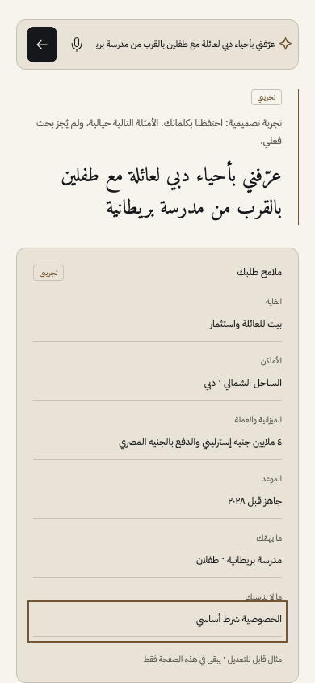
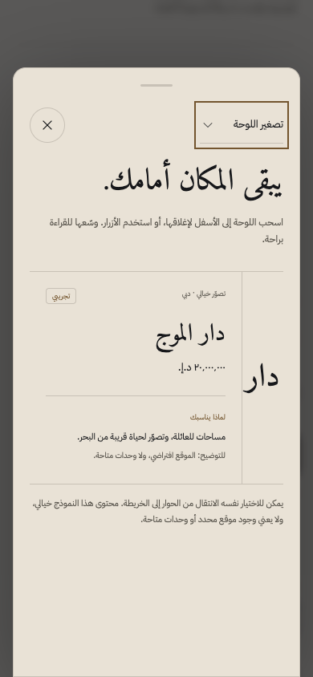

# Sheikha Al-Mansoori · Stage 1 re-review

This is a **simulated client review of Stage 1 Foundation & Design System**, not an interview, native Gulf Arabic approval or WCAG certification. The reviewer implemented legacy auth/preferences but did not build or edit the `/design` guide. The initial failing reports and images remain in [v1](../v1/). This review uses the repaired guide and fresh evidence rather than replacing the earlier findings.

## Scope and evidence

Scores judge the component foundation: AI-first means composer and reviewable brief readiness; map experience means layer controls and sheet readiness. A live city map, production concierge, actual finance comparison and the complete private office belong to later stages. Their absence is not a Stage 1 failure and these scores do not claim them complete.

The supplied [v3 manifest](../media/v3/manifest.json) records 12 configurations across EN/AR, dark/light and 390/1024/1440: zero axe violations, page errors or horizontal overflow. Representative supplied images were opened, including EN light 1024 and AR dark 1440 arrival, AR mobile sheet and AR mobile payment evidence. Independent fresh EN-dark/AR-light interactions ran at **390×844 with reduced motion**, recorded in [client-interactions.json](client-interactions.json). The corresponding numbered screenshots were saved and inspected. All three persona prompts were entered in each language; six brief fields were manually edited. The response explicitly says no live search occurred.

## Six-step recheck

1. **Arrival — strong.** Hierarchy and Arabic composition remain deliberate, with a keyboard skip link. See `01-{en,ar}-arrival.png`.
2. **Brief — repaired.** The same long budget/payment wording that clipped in v1 is fully visible in both languages; all six fields retained their text with no horizontal or vertical clipping. The single-column mobile composition is easier to review. See `02-{en,ar}-brief.png`.
3. **Currency/numerals — repaired and correct.** AED 20M converts to USD 5.446M and EGP 270M at the visible dated fictional rates. EGP installments remain 54M/162M/54M. Prices, percentages, comparison areas/years, payment timing and source dates now follow Arabic-Indic preference. The separate amount strip still explicitly disclaims conversion. See `03-{en,ar}-currency.png`.
4. **Spatial controls — repaired.** Schools updates both pressed state and visible status. Sheet height changes from **573.9px to 759.6px**, approximately 68→90svh, in both languages. Escape restores the opening trigger. See `04-{en,ar}-sheet.png`.
5. **Palette — repaired.** Opening focuses Search. ArrowUp from Search selects the last command. No-match feedback works; ArrowDown and Enter select Evidence. The selected heading owns focus and is visible, rather than leaving focus in the off-screen header. See `05-{en,ar}-palette.png` and JSON.
6. **Recovery — clear.** Keyboard retry replaces the error specimen with a localized ready status. No page overflow appeared in either independent flow. See `06-{en,ar}-recovered.png`.

The parent also supplied four passing focused design e2e tests and reports 40 unit/36 legacy AI evaluations passing, plus lint/typecheck/format. The native database report records PostgreSQL 16.2 + pgvector, 250 fictional units, 13 reference projects and zero invalid unit attachments. Those support foundation confidence, not independent verification of external project claims. The local browser felt responsive; no production LCP/INP, physical-phone frame benchmark, screen-reader session or native Gulf reader test was performed by this reviewer. The supplied videos were not used to assert frame-rate compliance. An AR tab cycle can reach browser/BODY focus; no background control activation was demonstrated, so it is not classified as a proven modal escape.

“Now the details are easier to check. The budget, family priority and privacy condition are readable together, and the Arabic retains the same quiet tone.”

## Scorecard

| Criterion            |    Score |
| -------------------- | -------: |
| First-5-seconds wow  |      9.5 |
| Originality          |        9 |
| AI-first             |        9 |
| Map experience       |        9 |
| Visual craft         |      9.5 |
| Motion quality       |        9 |
| Arabic & RTL         |        9 |
| Trust & evidence     |      9.5 |
| Discretion & privacy |      9.5 |
| Developer appeal     |        9 |
| Speed                |      8.5 |
| Accessibility        |        9 |
| **Mean**             | **9.12** |

No 10s are assigned. Improvements in AI-first, spatial, motion and accessibility scores reflect the observed brief, sheet and focus repairs—not completion of later features. Speed remains 8.5 because the production/device budgets have not been independently measured here.

## Three delights

1. “I can review my entire condition, not just the beginning.” The mobile Arabic brief shows the full budget/payment sentence and «الخصوصية شرط أساسي» without clipping.
2. “Arabic still feels considered.” The headline, right-to-left layout and larger evidence text retain the chosen character while prices, dates and areas follow the numeral preference.
3. “Discretion is backed by restraint.” The guide states its fictional status and page-only edits, keeps the original words visible, and never pretends a live property search or private entitlement has happened.

## Three remaining problems / risks

1. “Small labels still ask more effort than the main text.” Evidence/source text is improved, but badge labels and small installment numerals remain dense at 390px. Keep reading comfort under review with actual clients; zero axe findings do not measure this.
2. “The expanded panel is now useful, but this short example leaves a large quiet area below the content.” Test it with realistic longer bilingual recommendations during integration so expansion continues to feel purposeful.
3. “I want a Gulf reader to approve the voice before it speaks for my office.” The typography and RTL look coherent; idiom, tone and assistive reading of mixed dates/currencies remain human validation tasks, not claims this simulation can certify.

## Accepted visual evidence

## Verdict

“I would approve this foundation for the next stage. The earlier interaction defects are resolved, and the remaining reading and language checks are explicit.”

**This simulated persona passes the Stage 1 review gate:** mean 9.12 ≥ 9.0, minimum 8.5 ≥ 8. This is a bounded recommendation to advance the component foundation. It does not certify hosted CI, the entire review board, native Arabic quality, current market facts, full WCAG conformance or later production requirements.
